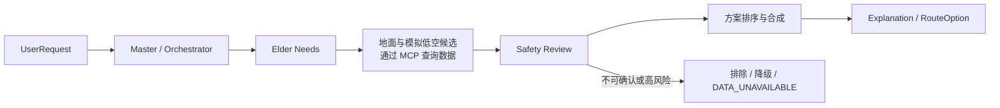

# SilverSky 产品运行时 Agent 架构草案

这里的 Agent 指产品内部规划组件，与 Codex 开发用的 Subagent 分开。MVP 先实现完整流程；角色可先由少量组件或确定性步骤承担，不为每个角色单独部署服务。

| 角色 | MVP 职责 | 边界 |
| --- | --- | --- |
| Master / Orchestrator | 控制步骤、保留来源状态、处理失败 | 不直接声称低空服务真实可用 |
| Elder Needs | 提取行动能力、协助需求、步行限制与未知项 | 不作医疗诊断 |
| Ground Transport | 从已登记地面数据形成候选地面段 | 不填补缺失 POI 或实时交通 |
| Low-altitude Planning | 只基于明确标记的模拟起降点与航线形成演示候选 | 不生成真实航班、运营状态或许可结论 |
| Safety | **审查已有候选**的安全、行动能力、换乘及数据不确定性，给出排除/降级理由 | 不凭空创建路线 |
| Explanation | 解释推荐和候选差异，保留模拟/不可用声明 | 不覆盖 Safety 审查结果 |

Weather 与 Aircraft 在首版可以是有来源状态的工具输入或 `DATA_UNAVAILABLE`，是否拆成独立 Agent 取决于数据可用性。Urban Planning 属后续候选。每个阶段的输入、输出和错误状态先服从 [API_CONTRACTS.md](API_CONTRACTS.md)；具体提示词和工具调用顺序需在 Sprint 设计时核验。

MVP 优先用单一编排流程承载上述角色，不按角色拆服务。候选生成后，Safety Review 对每条候选给出 `PASS`、`DOWNGRADE`、`REJECT` 或 `UNKNOWN` 和理由。真实地面推荐只从通过审查且数据充分的候选中产生；含模拟低空段的候选单列为情景演示，不能成为真实可执行出行建议。当前两城 Golden 地面结果为 `DOWNGRADE`、模拟低空为 `REJECT`；状态与证据见 [PROJECT_STATE.md](PROJECT_STATE.md)。
