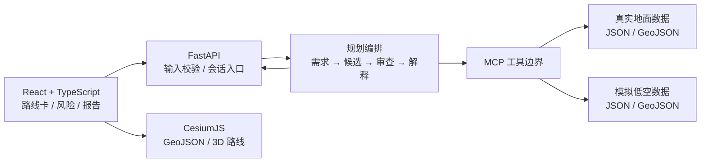

# MVP 技术架构草案

状态：基于已定技术方向的最小实施方案；具体服务接口由 [API_CONTRACTS.md](API_CONTRACTS.md) 和 [INTERFACES.md](INTERFACES.md) 管理。

## 模块职责

- **前端**：收集输入，展示候选路线、风险、来源状态和报告；CesiumJS 仅负责可视化，不判断航线运营可用性。
- **FastAPI**：一个后端服务承载薄 API 层、请求与响应校验和规划编排；不在 HTTP 层编造交通事实。
- **规划编排**：需求结构化、候选构建、Safety Review 和解释，优先用清晰步骤与确定性规则；模型输出须经过结构校验，安全规则不能只依赖自然语言提示。模拟低空候选作为情景演示单列，现实出行推荐须依据自身可核验数据。
- **MCP 工具边界**：查询已登记数据来源并返回来源、时间和状态；工具返回的“无数据”不得被模型填补为真实航空数据。
- **数据**：MVP 采用 JSON / GeoJSON 文件及最少的读取逻辑。未来 PostgreSQL/PostGIS、外部实时 API 属候选升级，当前不作依赖。

## 依赖顺序

先确定产品验收和数据状态，再确认核心 Schema 与跨模块接口；随后可按约定接口并行开发前端展示和后端/Agent 最小闭环。集成时从每城一个代表场景验证来源贯通、失败降级和地图标记。运行时 Agent 职责见 [AGENT_ARCHITECTURE.md](AGENT_ARCHITECTURE.md)。

## 实施注意

FastAPI 的请求和响应模型可用于入口/出口结构校验；MCP 工具可提供结构化输出，但消费方仍需校验。CesiumJS 加载地面 GeoJSON 与绘制带高度的模拟空中线需区分，空中线展示不构成可飞性证明。Cesium 资产服务与底图来源及许可待数据负责人确认。依据：[FastAPI 请求模型](https://fastapi.tiangolo.com/tutorial/body/)、[响应模型](https://fastapi.tiangolo.com/tutorial/response-model/)、[MCP Tools 规范](https://modelcontextprotocol.io/specification/2025-11-25/server/tools)、[Cesium GeoJsonDataSource](https://cesium.com/learn/cesiumjs/ref-doc/GeoJsonDataSource.html)、[Cesium PolylineGraphics](https://cesium.com/learn/cesiumjs/ref-doc/PolylineGraphics.html)。
